# UCM and Courthouse vNext through Workflow IR

Point-of-use use is documented in
[CCP-COURTHOUSE-BOUNDARY.md](CCP-COURTHOUSE-BOUNDARY.md). The r015 adapter
inserts an exact CCP admission step after durable intent and before G1, and
requires the returned G1 receipt to carry the admission-envelope, decision,
and current-use roots. This portable adapter does not claim an installed
Courthouse route or local capability lattice.

This is the stable integration boundary between UCM and Courthouse vNext.
Workflow IR is the protocol. Courthouse implementation paths, runner classes,
model adapters, and internal lattice versions are deliberately outside it.

## Plain-language view

UCM tells the courthouse **what must remain true**, **what evidence is needed**,
and **what effects may be requested**. Courthouse vNext decides whether it can
lawfully realize that work, selects an admitted executor, controls effects, and
returns a witnessed result. UCM then checks whether that result corresponds to
the original repository contract. Neither side silently assumes the other's
authority.

```mermaid
flowchart LR
    R[Repository + architecture contract] --> U[UCM compile]
    U --> W[Workflow IR envelope]
    W --> C[Courthouse vNext orientation and adjudication]
    C --> X[Admitted external executor]
    X --> G2[G2 witness]
    C --> G1[G1 sentinel]
    G1 --> X
    G2 --> G3[G3 diagnostic]
    G3 --> D[Courthouse disposition]
    D --> I[UCM correspondence import]
    I --> J[Portable campaign journal]
```



## Ownership

| Concern | Owner |
|---|---|
| Source, architecture contract, CM1 obligations, CM2 preferences | UCM/application |
| Workflow IR canonical serialization and request root | UCM |
| Capability-lattice resolution and realization route | Courthouse vNext |
| Authority, permits, executor selection, effects, budgets | Courthouse vNext / external authority |
| G1 Sentinel, G2 Witness, G3 Diagnostic receipts | Courthouse vNext |
| Evidence-producing tests and tools | Selected external executor |
| Result correspondence to the original UCM obligations | UCM |
| Admission, merge, release, or deployment disposition | External courthouse/governor |

UCM does not grant courthouse authority. Courthouse does not reinterpret or
replace the application-owned architecture contract. Chat text is never the
boundary artifact.

## Protocol records

1. `mosaic.ucm.courthouse-workflow-request.v0.1`
   binds the subject, architecture candidate, work package, CM1/CM2 contract,
   requested capability/effect inventory, policy packs, identities,
   jurisdiction, expected Courthouse vNext identity and protocol roots, and
   expected journal head. A result cannot nominate its own courthouse identity.
2. `mosaic.ucm.aok-vnext-workflow-ir.v0.1`
   deterministically lowers the request into Objective IR, Workflow IR,
   Capability IR, CCBA lattice binding, unresolved realization route, effect
   covenant, and obligation contract.
3. `mosaic.ucm.aok-vnext-workflow-result.v0.1`
   returns the courthouse identity, selected realization and executor, full
   G1/G2/G3 receipt bodies, CM1 dispositions, CM2 status, and successor journal
   head.
4. `mosaic.ucm.courthouse-result-import.v0.1`
   records correspondence. It is not a courthouse verdict, merge permission,
   or authority grant.

## Required semantics

- CM1 admissibility is evaluated before CM2 optimization.
- Each CM1 obligation carries its own root and evidence kind.
- Workflow IR lists `DURABLY_RECORD_INTENT` before external execution.
- An uncertain result may only be reconciled; it may not be redispatched.
- Capability IDs, effect classes, and budget roots are explicit.
- The G1 receipt precedes any observed effect.
- G2 records actual observed effect classes and evidence roots.
- G3 classifies the witnessed result and links to G2.
- The result starts from the request's exact expected journal head and returns a
  successor head.
- Progress events are nonsemantic and never substitute for receipts.

## UCM commands

```text
ucm courthouse-compile-workflow REQUEST.json WORKFLOW.json
ucm courthouse-verify-workflow REQUEST.json WORKFLOW.json
ucm courthouse-import-result REQUEST.json WORKFLOW.json RESULT.json IMPORT.json
```

All three commands are local deterministic computation. None contacts or
executes Courthouse vNext.

## vNext adapter contract

The vNext adapter consumes the compiled workflow and must:

1. orient to the current courthouse and capability lattice;
2. bind the compiled `required_units` to current vNext realizations;
3. refuse unresolved capabilities or budgets;
4. produce a signed/anchored G1 decision before effects;
5. dispatch only through an executor admitted by vNext;
6. preserve exact terminal output and observed effects in G2;
7. produce G3 and a courthouse disposition without altering the UCM request;
8. return the result record and its exact successor journal head.

The historical `vendor/aok-headless-runner` binding remains evidence of the
older interface. Its `PINNED_NOT_INSTALLED` state does not identify the vNext
executor and must not be promoted into this protocol.

## Initial acceptance cases

1. **Mosaic Terminal UI** — deterministic Windows/Linux build and tests, with
   physical keyboard/animation verification recorded as an external witness.
2. **Mosaic Vocal Lab** — state-bound REAPER operation, safe refusal on project
   drift, exact snapshot, and no retry after uncertain external state.
3. **Mosaic World Engine** — long-running heterogeneous build only after a
   stable source freeze, exercising progress isolation and large evidence sets.

The first two cases qualify the bridge. World Engine then demonstrates that the
same protocol scales without changing its semantics.

## Current boundary

This implementation remains `INFORMATION_ONLY`, has authority effect `NONE`,
keeps real A5 false, and keeps G0 closed. It defines and checks the interface;
it does not claim that Courthouse vNext has installed an adapter yet.

